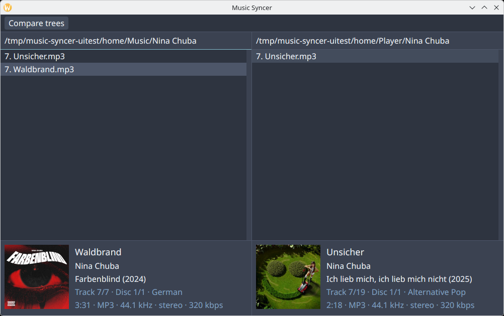
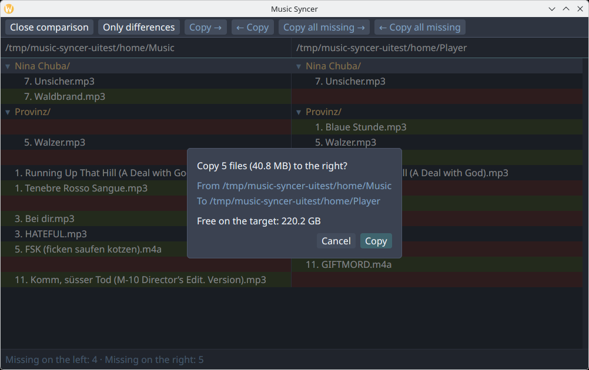

# Music Syncer

Music Syncer is a Linux app for comparing music folders and copying what’s missing from one to the other. Use it with two local folders or with a phone connected over MTP in KDE Plasma.

I started this project because I wanted to play around with [GPUI](https://www.gpui.rs/).



## Run from a checkout

The Nix flake builds Music Syncer for `x86_64-linux`. With flakes enabled, run this from the repository:

```sh
nix run .
```

The left panel opens in your XDG Music folder (or your home folder if Music isn’t configured). The right panel opens in your home folder. To start with two different folders, pass both paths:

```sh
nix run . -- "$HOME/Music" /path/to/other/library
```

You can also click the path at the top of either panel to choose a folder. To browse a phone, connect it in USB file transfer mode and select a folder inside its storage in the KDE file picker. MTP access uses KDE’s `kmtpd` service.

## Compare folders

Open the two folders you want to compare and click `Compare trees`. A green row shows an entry that exists on that side only; the red cell opposite it marks where it’s missing. Use `Only differences` to hide matching entries.


The comparison walks subfolders and matches entries by name and type. If a file has the same relative path on both sides, Music Syncer treats it as present on both without checking its contents or tags.

## Copy missing files

Use `Copy →` or `← Copy` to copy the selected file or the missing items under the selected folder. Use `Copy all missing →` or `← Copy all missing` to fill in the whole tree in that direction. The confirmation shows how many files and folders will be copied, their total size, and the target’s free space when available.



Copying adds missing entries. It leaves files that the comparison found on both sides alone and does not delete anything from either library.

## Development

```sh
nix develop
just run
```

Use `just test` to run the tests or `just check` to run the flake checks.
