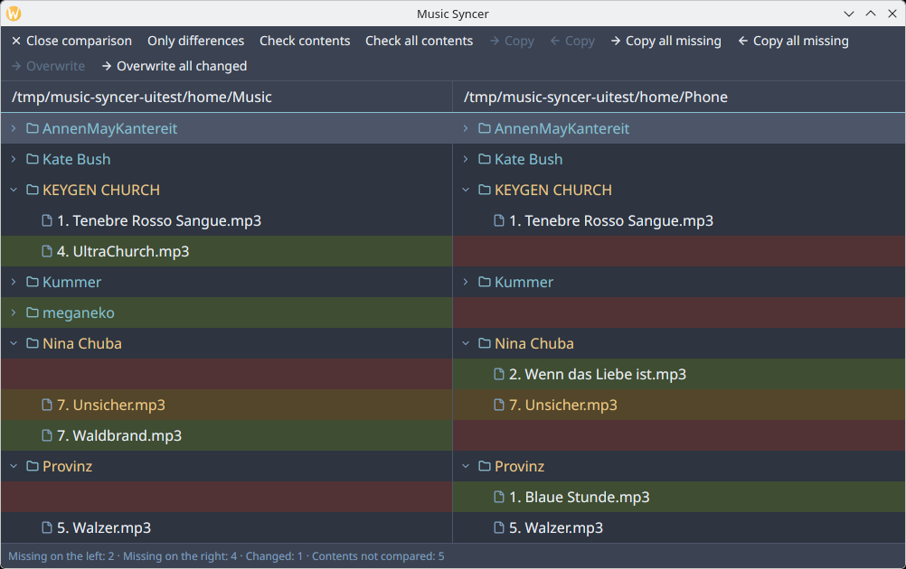
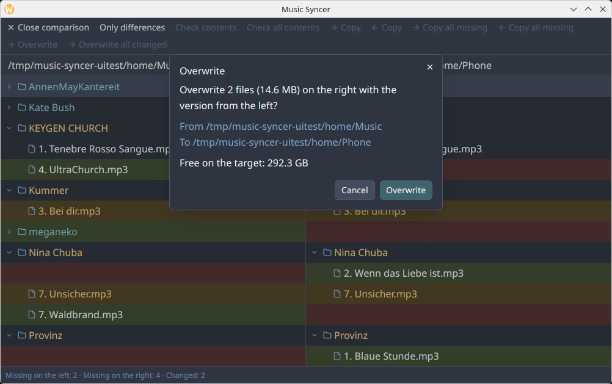

# Music Syncer

Music Syncer is a Linux app for comparing two music folders. It copies missing tracks in either direction and can overwrite changed files. You can use it with two local folders or with a phone connected over MTP in KDE Plasma.

I started this project because I wanted to play around with [GPUI](https://www.gpui.rs/). The UI uses [gpui-kit](https://crates.io/crates/gpui-kit).


## Run from a checkout

The Nix flake builds Music Syncer for `x86_64-linux`. With flakes enabled, run this from the repository:

```sh
nix run .
```

The left panel opens in your XDG Music folder (or your home folder if Music isn’t configured). The right panel opens in your home folder. To start with two different folders, pass both paths:

```sh
nix run . -- "$HOME/Music" /path/to/other/library
```

You can also click the folder button at the top right of either panel to choose a folder, or the arrow on the left to go up one level. To browse a phone, connect it in USB file transfer mode and select a folder inside its storage in the KDE file picker. MTP access uses KDE’s `kmtpd` service.

## Compare folders

Open the two folders you want to compare and click `Compare trees`. Rows appear as Music Syncer reads both trees. If reading takes a while, a progress toast shows up in the corner without blocking the list, so you can start browsing before it finishes.

A green row means an entry exists on that side only, with a red cell opposite it where it’s missing. A yellow row means a file exists on both sides with different contents. Click `Only differences` to hide matching entries.



Music Syncer walks subfolders and compares entries by name, type, and size. Files whose sizes differ turn yellow right away, while same-size files stay unchecked until you ask to compare their bytes. The status bar shows how many entries are missing, changed, or unchecked, and only reports that both sides match once the walk finishes with no unreadable folders.

## Copy missing files

Use `→ Copy` or `← Copy` to copy the selected file or the missing items under the selected folder; the arrow shows the direction. `→ Copy all missing` and `← Copy all missing` fill in the whole tree. Before copying, a dialog shows how many files and folders will be copied, their total size, and the target’s free space when available. After you confirm, the dialog shows progress and lets you cancel with `Stop` or `Escape`. Once copying ends, a notification shows what happened and stays open if anything failed or you stopped it.


Music Syncer syncs local copies to disk before reporting them done. Copying only adds missing entries. It leaves existing files alone and never deletes anything from either library.

## Check contents and overwrite changed files

To check same-size files that exist on both sides, click `Check contents` for the selected file or folder, or `Check all contents` for the whole tree. Music Syncer compares them byte by byte in the background, updates each row as it goes, and shows a progress toast with a `Stop` button (`Escape` stops it too). When the check ends, a notification shows how many files changed.

To replace changed files on the right with the version from the left, click `→ Overwrite` for the selected entry or folder, or `→ Overwrite all changed` for the whole tree. The confirmation dialog checks free space against the peak growth of the target as files are replaced one by one.



Local overwrites write to a temporary file, sync it to disk, and rename it into place. Over MTP, Music Syncer deletes the old file before uploading the replacement. If an upload fails, it removes the incomplete file and marks the entry as missing on the right so you can copy it again.

## Development

```sh
nix develop
just run
```

Use `just test` to run the tests or `just check` to run the flake checks. To run the opt-in MTP round-trip test against a connected phone, pass a folder on the phone (the test creates a temporary subfolder and removes it afterward):

```sh
just test-mtp mtp:/DEVICE/STORAGE/DIR
```
